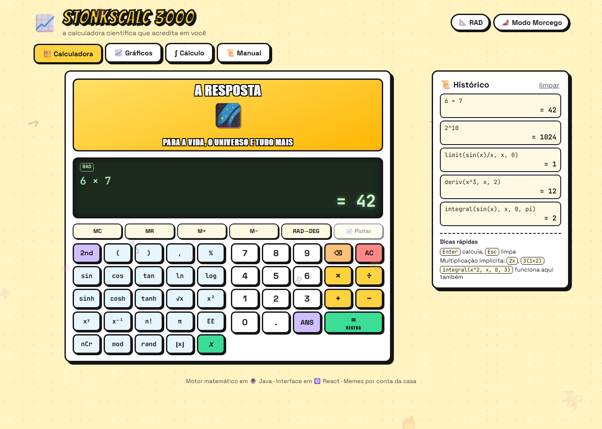
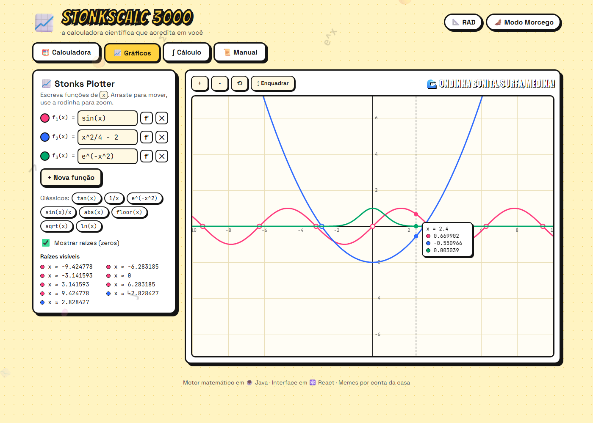
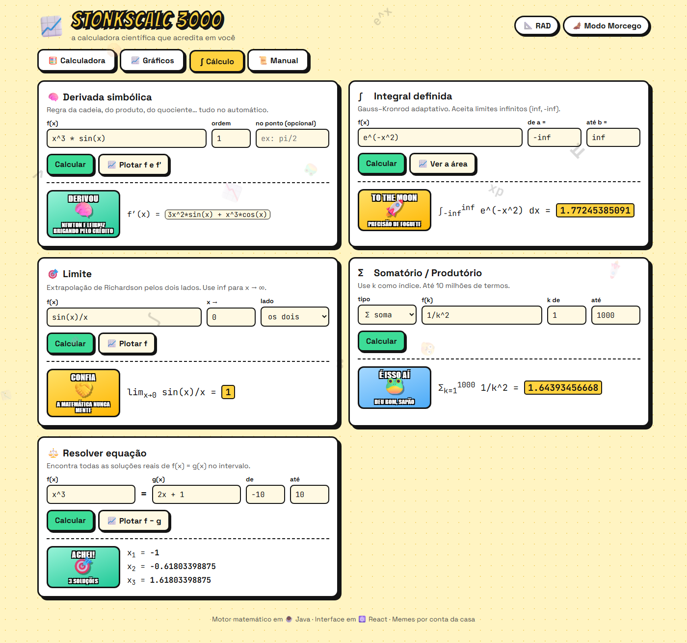
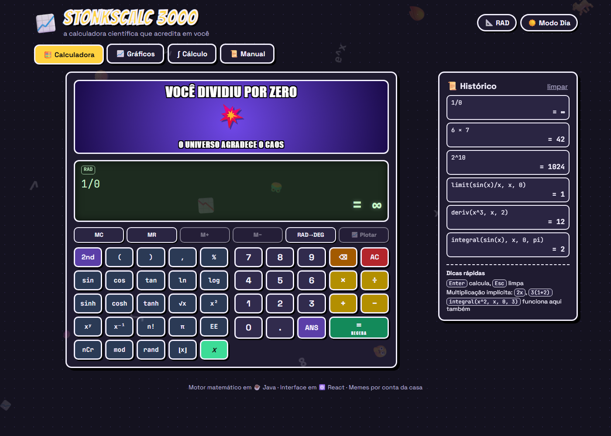
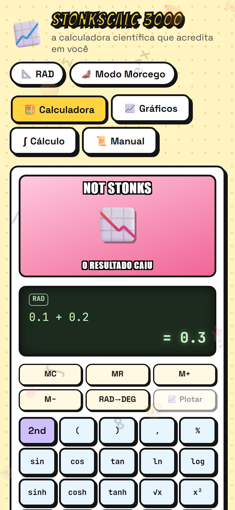
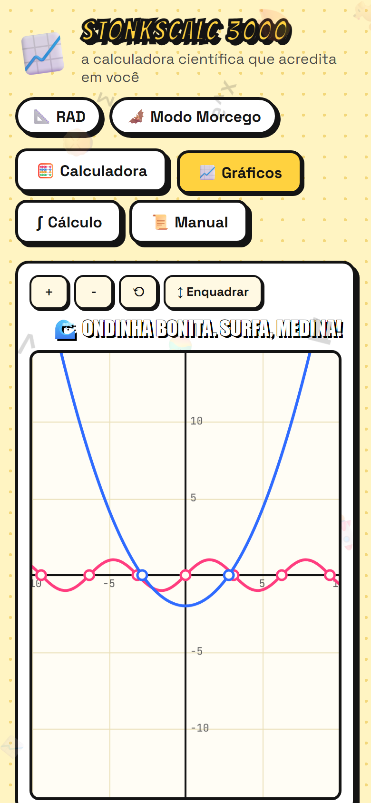
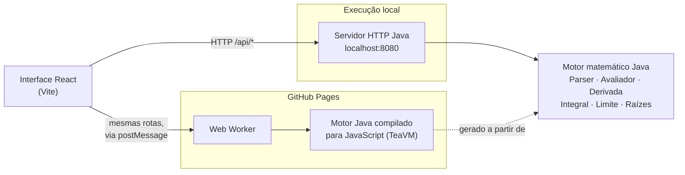

# StonksCalc 3000

<p align="center">
  <strong>Calculadora científica completa, com motor matemático em Java, interface em React e uma reação de meme para cada resultado.</strong>
</p>

<p align="center">
  
  
  
  
  
  
  <a href="https://github.com/MontenegroEngComp/stonkscalc-3000/actions/workflows/pages.yml"></a>
</p>

<p align="center">
  <a href="https://montenegroengcomp.github.io/stonkscalc-3000/"></a>
</p>

<p align="center">
  <a href="#demonstração-visual">Demonstração visual</a> •
  <a href="#funcionalidades">Funcionalidades</a> •
  <a href="#arquitetura">Arquitetura</a> •
  <a href="#tecnologias">Tecnologias</a> •
  <a href="#estrutura-de-pastas">Estrutura de pastas</a> •
  <a href="#pré-requisitos">Pré-requisitos</a> •
  <a href="#execução">Execução</a> •
  <a href="#build">Build</a> •
  <a href="#api">API</a> •
  <a href="#integração-contínua-e-deploy">Integração contínua e deploy</a> •
  <a href="#decisões-técnicas">Decisões técnicas</a> •
  <a href="#validações-realizadas">Validações realizadas</a> •
  <a href="#autora">Autora</a>
</p>

---

O **StonksCalc 3000** é uma calculadora científica que faz contas, deriva, integra, calcula limites, resolve equações e desenha gráficos interativos. Cada resultado vem acompanhado de uma reação em formato de meme: *STONKS* quando o resultado sobe, *THIS IS FINE* quando dá erro e *VOCÊ DIVIDIU POR ZERO* quando, bem, você divide por zero.

Todo o motor matemático foi escrito em **Java puro, sem nenhuma biblioteca externa**: o analisador de expressões, a derivação simbólica, as integrais numéricas, os limites e a busca de raízes. O mesmo código Java roda de duas formas:

- **Localmente**, como um servidor HTTP que atende a interface em React.
- **No GitHub Pages**, compilado para JavaScript pelo [TeaVM](https://teavm.org/) e executado direto no navegador, sem servidor.

🔗 **Acesse:** https://montenegroengcomp.github.io/stonkscalc-3000/

## Demonstração visual

<p align="center">
  
</p>

<p align="center">
  <em>6 × 7 = 42: a resposta para a vida, o universo e tudo mais. No histórico, uma integral, uma derivada e um limite calculados na própria calculadora.</em>
</p>

<p align="center">
  
</p>

<p align="center">
  
</p>

<p align="center">
  
</p>

<p align="center">
  
  &nbsp;
  
</p>

## Funcionalidades

### Calculadora

- Operações básicas, potências (`^`), fatorial (`!`), porcentagem (`%`) e notação científica (`1.5E3`).
- **Trigonometria** (sin, cos, tan, sec, csc, cot e inversas) nos modos **RAD** e **DEG**, com resultados exatos nos ângulos notáveis (`sin(180°) = 0`, `tan(90°)` indefinida).
- **Hiperbólicas**: sinh, cosh, tanh, sech, csch, coth e inversas.
- **Potências e logaritmos**: ln, log, log em qualquer base, log2, exp, √, ∛ e raiz n-ésima (com raízes ímpares de negativos: `(-8)^(1/3) = -2`).
- **Aritmética**: abs, floor, ceil, round com casas decimais, trunc, mod, MDC, MMC, min, max e hipotenusa.
- **Combinatória**: nCr, nPr, fatorial e função Gama Γ(x).
- **Estatística**: média, mediana, variância e desvio padrão (amostral e populacional).
- Memória (MC, MR, M+, M−), `ans` (resultado anterior), histórico persistente e tecla **2nd** para as funções inversas.
- Multiplicação implícita (`2x`, `3(1+2)`, `2pi`), parênteses fechados automaticamente e nomes em português (`sen`, `tg`, `raiz`, `mdc`, `mmc`).
- Resultados limpos, com até 12 algarismos significativos: `0.1 + 0.2 = 0.3`.

### Cálculo

- **Derivada simbólica** de qualquer ordem, com as regras da cadeia, do produto e do quociente, e valor da derivada em um ponto.
- **Integral definida** pelo método de Gauss–Kronrod adaptativo, inclusive com limites infinitos.
- **Limites** bilaterais, laterais e no infinito, por extrapolação de Richardson. Detecta quando os dois lados não concordam ou quando a função diverge.
- **Somatório Σ e produtório Π**, com até 10 milhões de termos.
- **Equações** `f(x) = g(x)`: encontra todas as soluções reais de um intervalo, inclusive raízes duplas, e ignora assíntotas.

Tudo isso também funciona direto no visor da calculadora:

```text
deriv(x^3, x, 2)                    → 12
integral(sin(x), x, 0, pi)          → 2
integral(e^(-x^2), x, -inf, inf)    → 1.77245385091
limit(sin(x)/x, x, 0)               → 1
limit((1 + 1/x)^x, x, inf)          → 2.718281828
sum(1/k^2, k, 1, 1000)              → 1.64393456668
solve(cos(x) - x, x)                → 0.739085133215
```

### Gráficos

- Até 8 funções ao mesmo tempo, cada uma com sua cor e opção de esconder.
- Arrastar para mover, rodinha do mouse para zoom e botão **Enquadrar**, que ajusta o eixo y às curvas ignorando picos de assíntotas.
- Raízes marcadas no eixo x e listadas ao lado.
- Cursor que mostra o valor de todas as funções no ponto.
- Assíntotas tratadas sem riscos verticais falsos (`tan(x)`, `1/x`).
- Botão **f′**, que adiciona o gráfico da derivada.
- Área da integral pintada sob a curva, a partir da aba Cálculo.

### Reações de meme

A legenda acima do visor muda conforme o resultado:

| Resultado | Reação |
| --- | --- |
| Maior que o anterior | 📈 *STONKS: o resultado subiu* |
| Menor que o anterior | 📉 *NOT STONKS: o resultado caiu* |
| `42` | 🌌 *A RESPOSTA: para a vida, o universo e tudo mais* |
| `1/0` | 💥 *VOCÊ DIVIDIU POR ZERO: o universo agradece o caos* |
| `0` | 🫏 *QUE BURRO, DÁ ZERO PRA ELE* |
| Acima de 9000 | 💪 *IT'S OVER 9000!!!* |
| Negativo | 📉 *NEGATIVADO: igual meu nome no Serasa* |
| `1 + 1` | 🎓 *1 + 1 = 2: ou 11, se você for de humanas* |
| Erro de sintaxe | 🔥🐶☕ *THIS IS FINE* |
| Fora do domínio | 🚫 *A MATEMÁTICA disse: não* |

Há ainda reações para 7, 10, 69, 100, 404, 1000, π e *e*, além de memes aleatórios para os demais resultados.

### Visual

- Estilo neobrutalista, com bordas grossas, sombras duras e legendas na fonte Impact, como nos memes clássicos.
- **Modo Morcego** 🦇: tema escuro.
- Layout responsivo, sem rolagem horizontal no celular.
- Animações desativadas para quem prefere movimento reduzido (`prefers-reduced-motion`).
- Endereço próprio para cada aba (`#calc`, `#graph`, `#calculus`, `#manual`).

## Arquitetura



- O motor matemático é um único código Java. O `CalcService` centraliza as rotas e é usado tanto pelo servidor HTTP quanto pela versão web.
- Localmente, a interface chama a API do servidor Java.
- No GitHub Pages, o TeaVM traduz o motor para JavaScript. A interface o executa num **Web Worker**, em segundo plano, para que gráficos e integrais não travem a tela.
- As duas formas respondem exatamente com o mesmo JSON. Se o servidor local estiver fora do ar, a interface passa a usar o motor do navegador automaticamente.

### Como uma expressão é calculada

1. O **Lexer** transforma o texto em tokens e aceita os símbolos da interface (×, ÷, −, π, √, ², ³).
2. O **Parser** monta a árvore sintática (AST) por descida recursiva, com precedência, potência associativa à direita e multiplicação implícita.
3. O **Evaluator** percorre a árvore. Funções de cálculo como `integral(...)` recebem a expressão ainda não avaliada e a transformam numa função `f(x)`.
4. A **Derivative** deriva a árvore simbolicamente, o **Simplifier** limpa o resultado (`0 + 2x·1` vira `2x`) e o **Formatter** devolve um texto que o próprio parser consegue ler de novo, o que permite plotar f′.

## Tecnologias

| Camada | Tecnologia | Versão |
| --- | --- | --- |
| Motor matemático e API | Java (records, sealed interfaces, pattern matching) | 21 |
| Servidor HTTP | `com.sun.net.httpserver` (JDK) com virtual threads | — |
| Java → JavaScript | TeaVM | 0.16.0 |
| Build Java (versão web) | Maven | 3.9 |
| Interface | React | 18.3 |
| Build do front-end | Vite | 5.4 |
| Gráficos | Canvas 2D (implementação própria) | — |
| Tipografia | Google Fonts: Bangers, Anton, Space Grotesk e JetBrains Mono | — |
| Deploy | GitHub Actions + GitHub Pages | — |

O backend não tem nenhuma dependência externa: o parser, o JSON e o servidor usam apenas a biblioteca padrão do Java.

## Estrutura de pastas

```text
.
├── .github/workflows/pages.yml     # Testes, build e deploy no GitHub Pages
├── backend/
│   ├── src/main/java/com/stonkscalc/
│   │   ├── Main.java               # Sobe o servidor HTTP
│   │   ├── api/
│   │   │   ├── ApiServer.java      # Rotas /api/* e arquivos do front-end
│   │   │   ├── CalcService.java    # Regras de cada endpoint
│   │   │   └── Json.java           # Parser e serializador JSON
│   │   └── engine/
│   │       ├── Lexer.java          # Texto → tokens
│   │       ├── Parser.java         # Tokens → árvore sintática
│   │       ├── Evaluator.java      # Árvore → número
│   │       ├── Functions.java      # Catálogo de funções e apelidos
│   │       ├── MathFunctions.java  # Implementação das funções
│   │       ├── Derivative.java     # Derivação simbólica
│   │       ├── Simplifier.java     # Simplificação algébrica
│   │       ├── Calculus.java       # Integrais, limites e raízes
│   │       └── Formatter.java      # Número e árvore → texto
│   ├── src/test/java/              # Testes do motor
│   ├── src/web/java/               # Ponto de entrada da versão web (TeaVM)
│   ├── build.ps1 / build.sh        # Compila, testa e gera o .jar sem Maven
│   └── pom.xml                     # Perfil "web" com o TeaVM
├── docs/images/                    # Capturas de tela usadas no README
├── frontend/
│   ├── public/engine/worker.js     # Web Worker que roda o motor no navegador
│   └── src/
│       ├── App.jsx                 # Abas, tema e estado global
│       ├── api.js                  # Cliente do motor (servidor ou navegador)
│       ├── memes.js                # Escolhe a reação de cada resultado
│       ├── styles.css              # Design tokens e estilos
│       └── components/
│           ├── Calculator.jsx      # Visor, teclado, memória e histórico
│           ├── Graph.jsx           # Plotter em canvas
│           ├── CalculusPanel.jsx   # Derivada, integral, limite, Σ e equações
│           ├── Manual.jsx          # Lista de funções vinda do motor
│           └── MemeCard.jsx        # Quadro de meme
├── start.ps1 / start.sh            # Compila tudo e sobe a aplicação
└── README.md
```

## Pré-requisitos

- [Java JDK 21+](https://adoptium.net/)
- [Node.js 18+](https://nodejs.org/) e npm
- [Git](https://git-scm.com/), para clonar o repositório
- [Maven 3.9+](https://maven.apache.org/) (opcional: só é necessário para gerar a versão web do motor)

Para rodar localmente não é preciso Maven: o backend compila só com o `javac` do JDK.

## Execução

### Online

A versão publicada no GitHub Pages não precisa de instalação: https://montenegroengcomp.github.io/stonkscalc-3000/

### Localmente, com um comando

```bash
git clone https://github.com/MontenegroEngComp/stonkscalc-3000.git
cd stonkscalc-3000
```

```powershell
# Windows (PowerShell)
.\start.ps1
```

```bash
# Linux / macOS
./start.sh
```

O script instala as dependências do front-end, roda os testes do motor, compila tudo e sobe o servidor. No Windows, o navegador abre sozinho em **http://localhost:8080**. Mantenha o terminal aberto enquanto usa a calculadora e use `Ctrl+C` para parar.

### Modo desenvolvimento, com hot reload

Em dois terminais:

```powershell
# Terminal 1: motor Java na porta 8080
cd backend
.\build.ps1 -Run          # Linux/macOS: ./build.sh run
```

```bash
# Terminal 2: interface React na porta 5173 (faz proxy de /api para a porta 8080)
cd frontend
npm install
npm run dev
```

Depois, acesse **http://localhost:5173**.

### Serviços e portas

| Serviço | URL |
| --- | --- |
| Aplicação completa (`start.ps1`) | http://localhost:8080 |
| API Java | http://localhost:8080/api/health |
| Interface em modo dev | http://localhost:5173 |

## Build

Backend: compila, roda os testes e gera `backend/target/stonkscalc.jar`.

```bash
cd backend
./build.sh                # Windows: .\build.ps1
```

Motor para o navegador: o TeaVM gera `frontend/public/engine/stonkscalc.js`.

```bash
mvn -f backend/pom.xml -P web package
```

Front-end, no mesmo formato do GitHub Pages:

```bash
cd frontend
npm ci
VITE_ENGINE=browser VITE_BASE=/stonkscalc-3000/ npm run build
```

| Variável | Efeito |
| --- | --- |
| `VITE_ENGINE=browser` | Usa sempre o motor compilado para JavaScript, sem procurar o servidor |
| `VITE_BASE` | Caminho base do site (no Pages, o nome do repositório) |
| `VITE_API_URL` | Endereço de um servidor Java em outro domínio (opcional) |

## API

Todas as rotas respondem JSON no formato `{ "ok": true, ... }` ou `{ "ok": false, "error": "mensagem" }`.

| Método | Rota | Corpo | Resposta |
| --- | --- | --- | --- |
| GET | `/api/health` | — | `{ status }` |
| GET | `/api/functions` | — | catálogo com nome, assinatura, descrição e categoria |
| POST | `/api/evaluate` | `{ expression, angleMode, variables }` | `{ value, display, infinite }` |
| POST | `/api/derivative` | `{ expression, variable, order, at }` | `{ derivative, steps, valueAt }` |
| POST | `/api/plot` | `{ functions, xMin, xMax, samples, angleMode, roots }` | `{ series: [{ ys, roots, error }] }` |
| POST | `/api/roots` | `{ expression, a, b, angleMode }` | `{ roots, display }` |

Exemplo:

```bash
curl -X POST localhost:8080/api/evaluate \
  -H "Content-Type: application/json" \
  -d '{"expression": "sin(30) + 5!", "angleMode": "DEG"}'
```

```json
{ "ok": true, "value": 120.5, "display": "120.5", "infinite": false }
```

Erros de cálculo voltam com status 200 e `ok: false`, com mensagens em português, por exemplo *"Variável desconhecida: 'foo'"*. JSON inválido retorna 400, e rotas inexistentes, 404.

## Integração contínua e deploy

O workflow [`.github/workflows/pages.yml`](.github/workflows/pages.yml) roda a cada push na `main`, em pull requests e manualmente:

1. **Testes do motor**: compila o backend e executa a bateria de testes.
2. **Motor Java → JavaScript**: `mvn -P web package` gera o motor para o navegador com o TeaVM.
3. **Front-end**: `npm ci` e build do Vite com `VITE_ENGINE=browser`.
4. **Deploy**: publica `frontend/dist` no GitHub Pages (só na `main`).

Em pull requests, o workflow roda os testes e o build, mas não publica.

## Decisões técnicas

- **Motor próprio, sem bibliotecas**: o parser, a derivação simbólica e os métodos numéricos foram implementados do zero. O backend usa apenas o JDK.
- **Um código, dois ambientes**: o mesmo Java roda como servidor e, compilado pelo TeaVM, no navegador. Assim o site no GitHub Pages funciona sem servidor e sem reescrever o motor em JavaScript.
- **Web Worker**: no navegador, o motor roda fora da thread da interface, e gráficos com milhares de pontos não travam a tela.
- **AST com sealed interfaces e records**: a árvore sintática é um `sealed interface Node`, e o avaliador, o derivador e o formatador usam `switch` com pattern matching, que garante na compilação que todos os tipos de nó foram tratados.
- **Avaliação preguiçosa nas funções de cálculo**: `integral(f, x, a, b)` recebe `f` como árvore, não como número, e a transforma numa função de `x`. Isso permite usar integrais, limites e somatórios dentro de qualquer expressão, inclusive aninhados.
- **Gauss–Kronrod adaptativo (G7-K15)**: estima o erro em cada intervalo e só subdivide onde é preciso. Não avalia as extremidades, por isso integra singularidades como `1/√x` em 0. Limites infinitos são tratados por mudança de variável.
- **Limites por extrapolação de Richardson**: aproxima o ponto pelos dois lados com passos cada vez menores e extrapola. Detecta divergência para ±∞ e informa quando os limites laterais são diferentes.
- **Raízes robustas**: varredura com bisseção para trocas de sinal, busca da seção áurea para raízes que só tocam o eixo (como em `x²`) e descarte de assíntotas (como em `tan(x)`).
- **Erros de domínio como NaN**: `sqrt(-1)` vira um buraco no gráfico em vez de derrubar a curva inteira. Na calculadora, vira uma mensagem amigável.
- **Ruído de ponto flutuante tratado**: resultados com 12 algarismos significativos e ângulos notáveis exatos, então `sin(π)` dá 0 e não `1.22E-16`.
- **Saída da derivada reaproveitável**: o `Formatter` gera um texto que o próprio parser lê de novo, e é isso que permite o botão **f′** plotar a derivada.
- **Gráfico sem estouro no celular**: `minmax(0, 1fr)` impede que a largura natural dos elementos force rolagem horizontal.
- **Servidor seguro para arquivos**: o servidor estático normaliza os caminhos e bloqueia tentativas de sair da pasta do front-end (path traversal).

## Validações realizadas

Validações executadas localmente na finalização do projeto:

| Validação | Resultado |
| --- | --- |
| Bateria de testes do motor (`build.ps1`) | 111 testes aprovados, 0 falhas |
| Motor compilado para JavaScript comparado com o Java (15 expressões, como integrais infinitas, limites, derivadas e estatística) | Resultados idênticos, inclusive nas mensagens de erro |
| Endpoints da API com `curl` | Respostas corretas; JSON inválido retorna 400 e rota inexistente, 404 |
| Tentativa de path traversal no servidor estático | Bloqueada; o servidor devolve a página inicial |
| Site estático (build do Pages) no Edge, **sem servidor Java** | Contas, as 5 ferramentas de cálculo, gráfico com 9 raízes e manual com 63 funções funcionando |
| Console do navegador durante todo o uso | Nenhum erro |
| Renderização em 390px (celular) | Sem rolagem horizontal; gráfico exibido antes da lista de funções |
| Tema escuro (Modo Morcego) na tela da calculadora | Fundo, teclado, visor, meme e histórico com as cores do tema escuro |
| `start.ps1` executado a partir de outra pasta | Servidor sobe e serve a aplicação |

## Autora

**Clarisse Maria Cabral Montenegro**
